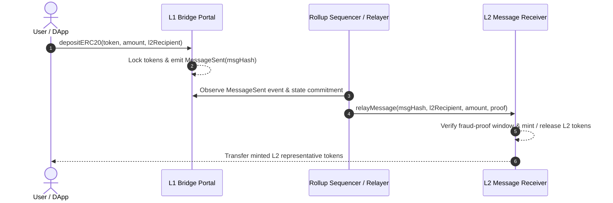

# EVM Layer 2 Optimistic Bridge & Message Relayer

[](https://soliditylang.org/)
[](https://getfoundry.sh/)
[](https://opensource.org/licenses/MIT)

A trust-minimized, dispute-enabled cross-domain bridging protocol enabling bidirectional asset transfers and arbitrary message relaying between Ethereum Layer 1 and high-throughput EVM Layer 2 rollups.

---

## 🏗 Bridge Protocol Architecture



## 🔒 Security & Verification Engine

- **Fraud Proof Challenge Window**: 7-day state dispute period with cryptographic Merkle mountain range inclusion verification.
- **ERC-4337 Compatible Gas Abstraction**: Relayer paymasters allow users to bridge gaslessly with fee sponsorship.
- **Reentrancy & Rate Limiting**: Token-specific velocity caps and non-reentrant execution gates on both L1/L2 domains.

## 📂 Repository Layout

```text
├── contracts/
│   ├── IL2CrossDomainMessenger.sol
│   ├── L1StandardBridge.sol
│   └── L2StandardBridge.sol
├── test/
│   └── Bridge.t.sol
├── script/
│   └── DeployBridge.s.sol
└── foundry.toml
```

## 🚀 Building & Testing

```bash
# Compile contracts with via-IR optimizer enabled
forge build

# Run unit tests and invariant fuzz tests
forge test -vvv
```

## 📄 License
MIT
